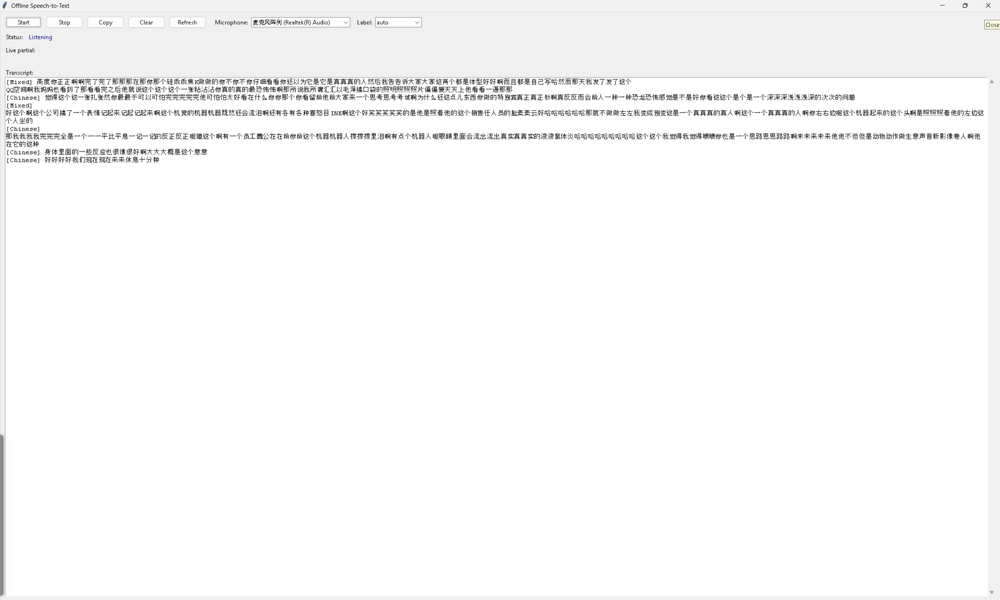
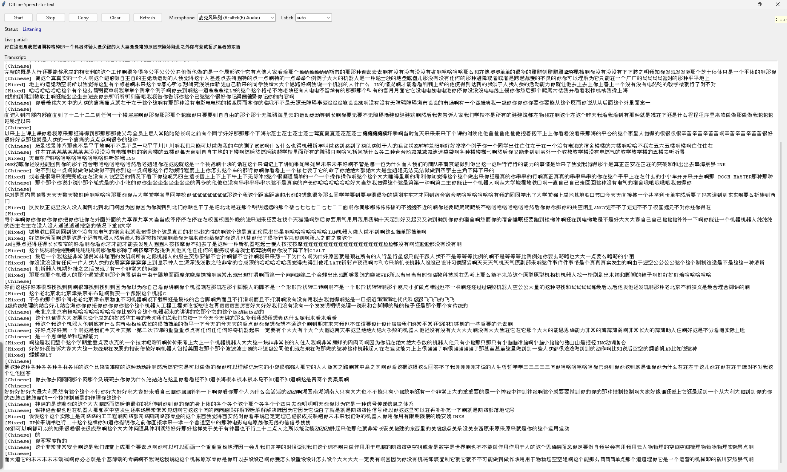

# Offline Real-Time Speech-to-Text

[](https://github.com/Shudipto-creator/Offline-Real-Time-Speech-to-Text/actions/workflows/ci.yml)
[](LICENSE)
[](pyproject.toml)

A lightweight, fully offline, pure-Python desktop application that continuously monitors your computer microphone and converts spoken audio into text in real time. Supports Mandarin Chinese and English recognition with no wake word required.

> 中文说明见 [部署和使用说明.txt](部署和使用说明.txt)

---

## Table of Contents

1. [Overview](#overview)
2. [Screenshots](#screenshots)
3. [Key Features](#key-features)
4. [Requirements](#requirements)
5. [Quick Start](#quick-start)
6. [Installation](#installation)
7. [Model Download](#model-download)
8. [Usage](#usage)
9. [GUI Controls Explained](#gui-controls-explained)
10. [Configuration](#configuration)
11. [Offline Operation](#offline-operation)
12. [Project Structure](#project-structure)
13. [Testing](#testing)
14. [Troubleshooting](#troubleshooting)
15. [Architecture](#architecture)
16. [Documentation](#documentation)
17. [License](#license)

---

## Overview

This project implements a real-time speech-to-text (ASR) system that runs entirely on your local machine. It captures audio from the microphone through `sounddevice`, processes it with a streaming transducer model from `sherpa-onnx`, and displays both partial (live) and final (committed) transcription results in a Tkinter graphical interface.

Unlike voice assistants that wait for a wake word, this application starts recognizing speech as soon as you press **Start**. It is designed for continuous, natural speech input rather than short command spotting.

## Screenshots

| Main window while recognition is running | Committed transcript with language labels |
|---|---|
|  |  |
| Status bar shows **Listening**, with the live partial text, the committed transcript, and the microphone selector. | Every committed utterance is tagged automatically with a language label such as `[Chinese]` or `[Mixed]`. |

Both images are real captures of this application running on Windows.

## Key Features

- **Real-time continuous listening**: Monitors the microphone and produces text as you speak, with partial results updating live.
- **No wake word**: Recognition begins immediately on Start; no trigger phrase is required.
- **Bilingual (Mandarin Chinese + English)**: Uses the sherpa-onnx streaming Zipformer bilingual model trained on both languages.
- **Fully offline**: All model files live locally; no network requests are made during recognition.
- **Lightweight**: Uses int8 quantized models and runs on CPU only.
- **Pure Python**: The entire application is implemented in Python with standard and third-party Python libraries only.
- **Tkinter desktop GUI**: Microphone selection, Start/Stop/Copy/Clear controls, live partial text, final transcript with language labels.
- **Endpoint detection**: Automatically commits final text after a pause in speech.
- **Audio device selection**: Choose any available input device from a dropdown.
- **Privacy by design**: Microphone audio is processed in memory, never written to disk, and logs never contain audio or transcript text.

## Requirements

### Hardware

- Windows 10 or Windows 11 (64-bit)
- A working microphone (built-in, USB, or headset)
- CPU (no GPU required)

### Software

- Python 3.11 (64-bit)
- pip (included with Python)

### Python Dependencies

| Package | Version | Purpose |
|---------|---------|---------|
| numpy | 2.4.6 | Audio array handling |
| sounddevice | 0.5.6 | Microphone audio capture |
| sherpa-onnx | 1.13.8 | Offline streaming speech recognition |
| pytest | 9.1.1 | Testing (optional) |

## Quick Start

```powershell
git clone https://github.com/Shudipto-creator/Offline-Real-Time-Speech-to-Text.git
cd Offline-Real-Time-Speech-to-Text

python -m venv venv
venv\Scripts\activate
python -m pip install --upgrade pip
python -m pip install -r requirements.txt

# One-time: fetch the offline model (~487 MB archive)
python scripts\download_models.py

# Run
set PYTHONPATH=src
python -m speech2text.main
```

In PowerShell, set the path with `$env:PYTHONPATH="src"` instead of `set PYTHONPATH=src`.

> **The model files are not in this repository.** The quantized encoder alone is
> ~173 MB, and GitHub rejects any file larger than 100 MB. Run
> `python scripts/download_models.py` once to download and extract them into
> `models/`. Everything after that step works fully offline.

## Installation

### Step 1: Create and activate a virtual environment

Open PowerShell or Command Prompt in the project folder:

```powershell
cd speech2text
python -m venv venv
venv\Scripts\activate
```

### Step 2: Upgrade pip and install dependencies

```powershell
python -m pip install --upgrade pip
python -m pip install -r requirements.txt
```

### Step 3: Download the model

```powershell
python scripts\download_models.py
```

This downloads the official sherpa-onnx release archive (~487 MB) and extracts it
into `models/`. This step requires network access and is performed only once.

### Step 4: Verify the environment

```powershell
set PYTHONPATH=src
python scripts\check_setup.py
```

Expected output:

```
=== Speech-to-text environment check ===
Python: 3.11.9 (64-bit)
Platform: Windows-10-10.0.26300-SP0
OK import: numpy
OK import: sounddevice
OK import: sherpa_onnx
OK model file: encoder-epoch-99-avg-1.int8.onnx (181895032 bytes)
OK model file: decoder-epoch-99-avg-1.int8.onnx (13091040 bytes)
OK model file: joiner-epoch-99-avg-1.int8.onnx (3228404 bytes)
OK model file: tokens.txt (56317 bytes)
Input devices:
  [0] Microsoft Sound Mapper - Input (2 in channels)
OK app modules: no network clients found in runtime code
OK recognizer load
```

If any step fails, see the [Troubleshooting](#troubleshooting) section.

## Model Download

The bilingual model files are **not** committed to this repository because the
quantized encoder is ~173 MB and GitHub refuses files over 100 MB. Download them
once with the bundled script:

```powershell
python scripts\download_models.py
```

The script downloads
`sherpa-onnx-streaming-zipformer-bilingual-zh-en-2023-02-20.tar.bz2` from the
official [sherpa-onnx releases](https://github.com/k2-fsa/sherpa-onnx/releases/tag/asr-models),
extracts it into `models/`, verifies that the encoder, decoder, joiner and
`tokens.txt` are present and non-empty, and deletes the archive. The resulting
layout is:

```
models/sherpa-onnx-streaming-zipformer-bilingual-zh-en-2023-02-20/
├── encoder-epoch-99-avg-1.int8.onnx   # Quantized encoder (181 MB)
├── decoder-epoch-99-avg-1.int8.onnx   # Quantized decoder (13 MB)
├── joiner-epoch-99-avg-1.int8.onnx    # Quantized joiner (3 MB)
├── tokens.txt                         # Token vocabulary (56 KB)
└── README.md                          # Model license and origin
```

The model is licensed by its authors under Apache-2.0; its attribution file is
kept in the repository.

## Usage

### Launch the application

```powershell
set PYTHONPATH=src
python -m speech2text.main
```

The Tkinter window titled "Offline Speech-to-Text" will open.

### Recognize speech

1. **Select a microphone** from the dropdown (defaults to the preferred real hardware mic).
2. **Press Start** — the status changes to "Loading model…" then "Listening".
3. **Speak naturally** into the microphone. Partial text appears in the "Live partial" area as you speak.
4. **Pause speaking** — after the configured trailing silence (default ~2.4 seconds), the final text is committed to the "Transcript" area with a language label such as `[Chinese]` or `[English]`.
5. **Press Stop** to end the session safely.
6. **Press Copy** to copy the full transcript to the clipboard.
7. **Press Clear** to empty the transcript.

## GUI Controls Explained

| Control | Description |
|---------|-------------|
| **Start** | Begins microphone capture and recognition. Loads the model on first press. |
| **Stop** | Stops the audio stream, flushes any remaining utterance, and returns to idle. |
| **Copy** | Copies the entire transcript text to the Windows clipboard. |
| **Clear** | Empties the transcript display and clears the live partial text. |
| **Refresh** | Re-scans available audio input devices and repopulates the dropdown. |
| **Microphone dropdown** | Select which input device to use. Prefers real hardware microphones over the Windows Sound Mapper. |
| **Label dropdown** | Display language preference: `auto` (detect from text), `Chinese`, or `English`. |
| **Status bar** | Shows current state: Idle, Loading model…, Listening, Stopping, Error. |
| **Live partial** | Real-time recognition output while you are speaking. |
| **Transcript** | Committed final utterances, each prefixed with a detected language label. |

## Configuration

Runtime settings are stored in `config.json`. You can edit it with any text editor.

### `config.json` sections

| Section | Key | Default | Description |
|---------|-----|---------|-------------|
| `model` | `encoder` | `models/.../encoder-epoch-99-avg-1.int8.onnx` | Path to quantized encoder ONNX model |
| `model` | `decoder` | `models/.../decoder-epoch-99-avg-1.int8.onnx` | Path to quantized decoder ONNX model |
| `model` | `joiner` | `models/.../joiner-epoch-99-avg-1.int8.onnx` | Path to quantized joiner ONNX model |
| `model` | `tokens` | `models/.../tokens.txt` | Path to token vocabulary file |
| `audio` | `sample_rate` | `16000` | Target sample rate for recognition (Hz) |
| `audio` | `channels` | `1` | Mono audio |
| `audio` | `block_duration_ms` | `100` | Audio block size captured per callback |
| `audio` | `device_index` | `null` | `null` = auto-select preferred microphone |
| `audio` | `max_queue_blocks` | `100` | Maximum queued audio blocks before dropping |
| `endpoint` | `trailing_silence_seconds` | `2.4` | Silence required to commit final text |
| `endpoint` | `short_trailing_silence_seconds` | `1.2` | Short-pause endpoint rule |
| `endpoint` | `max_utterance_length_seconds` | `20.0` | Maximum length of a single utterance |
| `pipeline` | `num_threads` | `2` | CPU threads for model inference |
| `pipeline` | `provider` | `cpu` | Execution provider (`cpu` or `cuda`) |
| `pipeline` | `max_active_paths` | `4` | Beam search active paths |
| `pipeline` | `decoding_method` | `greedy` | Decoding strategy (`greedy` or `modified_beam_search`) |
| `pipeline` | `enable_endpoint` | `true` | Enable automatic endpoint detection |
| `pipeline` | `language_mode` | `auto` | Language mode (`auto`, `chinese`, `english`) |
| `gui` | `poll_interval_ms` | `50` | GUI event polling interval |
| `gui` | `max_transcript_lines` | `200` | Maximum transcript lines retained |
| `gui` | `window_title` | `Offline Speech-to-Text` | Window title text |
| `gui` | `window_width` | `700` | Window width in pixels |
| `gui` | `window_height` | `600` | Window height in pixels |
| `refinement` | `enabled` | `false` | Optional post-processing refinement (disabled) |
| `refinement` | `model_size` | `tiny` | Refinement model size (if enabled) |
| `refinement` | `device` | `cpu` | Refinement device |
| `refinement` | `compute_type` | `int8` | Refinement compute type |
| `refinement` | `min_text_length` | `4` | Minimum text length for refinement |

### Example: Faster endpoint commits

To commit final text sooner after you stop speaking, reduce the trailing silence:

```json
"endpoint": {
  "trailing_silence_seconds": 1.0,
  "short_trailing_silence_seconds": 0.6,
  "max_utterance_length_seconds": 20.0
}
```

### Example: Lower CPU usage

```json
"pipeline": {
  "num_threads": 1,
  "provider": "cpu"
}
```

## Offline Operation

This application is designed for local-only execution:

- **Model files are local**: After the one-time download, all ONNX models and the token file reside in `models/`.
- **No network during recognition**: The runtime code under `src/speech2text/` does not import `urllib`, `requests`, `httpx`, `socket`, or any other network client library.
- **Audio stays on your machine**: Microphone audio is processed in memory and never uploaded.
- **No audio on disk**: The app never writes microphone audio to a file.
- **Clean logs**: Log files under `logs/` contain technical diagnostics only — never audio and never transcript text.
- **The only network-dependent script** is `scripts/download_models.py`, which you run manually once to fetch the model archive. It is not used during normal operation.

You can verify offline readiness with:

```powershell
set PYTHONPATH=src
python scripts\check_setup.py
```

The check confirms model files are present, the recognizer loads locally, and no network clients are imported in the runtime code.

## Project Structure

```
speech2text/
├── src/speech2text/                # Python source code
│   ├── main.py                     # CLI entry point (argparse, launches GUI)
│   ├── gui.py                      # Tkinter desktop interface
│   ├── recognizer.py               # sherpa-onnx OnlineRecognizer wrapper
│   ├── audio.py                    # sounddevice microphone capture
│   ├── pipeline.py                 # Worker thread: audio + recognition coordination
│   ├── config.py                   # Configuration dataclasses and loading
│   ├── language.py                 # Language label heuristics (Chinese/English/Mixed)
│   ├── refinement.py               # Optional final-sentence refinement (disabled by default)
│   ├── logging_setup.py            # Rotating file + console logging
│   ├── __init__.py                 # Package exports
│   └── __main__.py                 # `python -m speech2text` support
├── models/                         # Downloaded model files (not committed)
│   └── sherpa-onnx-streaming-zipformer-bilingual-zh-en-2023-02-20/
│       ├── encoder-epoch-99-avg-1.int8.onnx
│       ├── decoder-epoch-99-avg-1.int8.onnx
│       ├── joiner-epoch-99-avg-1.int8.onnx
│       ├── tokens.txt
│       └── README.md               # Model license / attribution
├── scripts/
│   ├── check_setup.py              # Environment verification script
│   └── download_models.py          # Model archive downloader (one-time, needs network)
├── tests/
│   ├── conftest.py                 # Shared pytest config, skips model-dependent tests
│   ├── test_core.py                # Config / language / recognizer tests
│   └── test_stage8.py              # Audio capture and pipeline tests
├── docs/
│   ├── IMPLEMENTATION_SPECIFICATION.pdf  # Project implementation specification
│   └── screenshots/
│       ├── app-main-window.png     # Screenshot: main window while listening
│       └── app-transcript.png      # Screenshot: transcript with language labels
├── .github/workflows/ci.yml        # Automated test pipeline (Windows + Linux)
├── requirements.txt                # Python package requirements
├── config.json                     # Runtime configuration
├── pyproject.toml                  # Project metadata and packaging
├── 部署和使用说明.txt               # Deployment and usage instructions (Chinese)
├── README.md                       # This file
└── venv/                           # Virtual environment (local, created during setup)
```

## Testing

```powershell
python -m pip install -r requirements.txt
python -m pytest -v
```

Tests that need the recognition model are skipped automatically when the model
files have not been downloaded, so the suite passes on a fresh clone.

Continuous integration runs the suite on Windows and Linux on every push:

[](https://github.com/Shudipto-creator/Offline-Real-Time-Speech-to-Text/actions/workflows/ci.yml)

## Troubleshooting

| Problem | Possible Cause | Solution |
|---------|---------------|----------|
| `ModuleNotFoundError: No module named 'speech2text'` | `PYTHONPATH` not set | Run `set PYTHONPATH=src` before launching, or `python -m pip install -e .` |
| `ModuleNotFoundError: No module named 'sherpa_onnx'` | Dependencies not installed | Activate venv and run `pip install -r requirements.txt` |
| `Model file not found: ...` | Model not downloaded yet | Run `python scripts\download_models.py` |
| No microphone devices detected | Mic disabled or permissions | Check Windows Settings > Privacy & security > Microphone; ensure apps can access the mic |
| "No audio from microphone" error | Wrong device selected or muted | Select a different device from the dropdown; unmute the mic; speak louder |
| Recognition produces garbled or empty text | Audio too quiet or noisy | Move closer to the mic; reduce background noise; check input volume in Windows sound settings |
| Final text never commits | Endpoint threshold too high | Lower `endpoint.trailing_silence_seconds` in `config.json` |
| High CPU usage | Too many inference threads | Reduce `pipeline.num_threads` to 1 in `config.json` |
| Window fails to open | Tkinter backend issue | Ensure you are running on Windows with a display; avoid headless/SSH sessions |

## Architecture

```
+----------------+      +----------------+      +------------------+
|   Tkinter GUI  |<---->|  GUI Queue     |<---->| RecognitionWorker|
|  (gui.py)      |      |  (thread-safe) |      |  (pipeline.py)   |
+----------------+      +----------------+      +------------------+
                                                    |
                                                    v
+----------------+      +----------------+      +------------------+
|                |<-----|  Recognizer    |<-----|  AudioCapture    |
|                |      |  (recognizer.py|      |  (audio.py)      |
|   Microphone   |----->|  sounddevice   |      |  sounddevice     |
|   (sound card) |      |  InputStream   |      |  InputStream     |
+----------------+      +----------------+      +------------------+
                                                   |
                                                   v
                                            +-----------+
                                            | sherpa-   |
                                            | onnx      |
                                            | Online    |
                                            | Recognizer|
                                            +-----------+
```

1. `AudioCapture` opens a `sounddevice.InputStream` callback that converts microphone audio to mono float32 at 16 kHz and enqueues 100 ms blocks.
2. `RecognitionWorker` runs on a background thread, dequeues audio blocks, loads the sherpa-onnx model, and feeds samples to the `OnlineRecognizer`.
3. `Recognizer` wraps `sherpa_onnx.online_recognizer.OnlineRecognizer`, handling streaming decode, endpoint detection, and stream reset.
4. Recognition events (`PARTIAL`, `FINAL`, `STATUS`, `ERROR`) are pushed to a thread-safe queue.
5. `SpeechToTextApp` (Tkinter) polls the queue every 50 ms and updates the live partial text, transcript, and status bar.

## Documentation

| Document | Description |
|----------|-------------|
| [部署和使用说明.txt](部署和使用说明.txt) | Full deployment and usage guide (Chinese) |
| [docs/IMPLEMENTATION_SPECIFICATION.pdf](docs/IMPLEMENTATION_SPECIFICATION.pdf) | Project implementation specification (English) |
| [docs/screenshots/](docs/screenshots/) | Screenshots of the running application |

## License

MIT License. See [LICENSE](LICENSE) for details.

The bundled model, `sherpa-onnx-streaming-zipformer-bilingual-zh-en-2023-02-20`, is
distributed by its authors under Apache-2.0 and is downloaded separately by
`scripts/download_models.py`.
